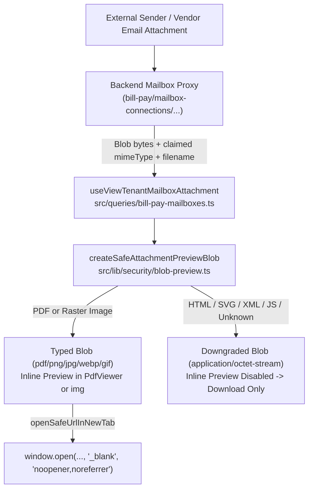

# Threat Model — Villeto Spend Management & Procurement Frontend (`villeto-app`)

> **Methodology & Tooling Note:** Microsoft Threat Modeling Tool (TMT) could not be executed in this headless CLI assessment environment because no TMT installation is present. Equivalent architecture Data Flow Diagrams (Mermaid) and a structured 12-attribute STRIDE threat register are documented below based strictly on inspected implementation evidence in `villeto-app`.

---

## 1. System Architecture & Trust Boundaries

`villeto-app` is a **Next.js 16 (App Router) / React 19 / TypeScript** web application serving B2B financial workflows (expenses, reimbursements, procurement PRs/POs/receipts, bill pay, mailbox invoice ingestion, vendor network, role/user administration, and multi-legal-entity switching).

All persistent relational database access, password verification, JWT/refresh-token issuance, server-side authorization enforcement, payment execution, email OAuth secret storage, and file storage orchestration reside outside this repository in the external backend API (`villeto-monolith`, configured via `API_BASE_URL` / `NEXT_PUBLIC_API_BASE_URL`), fronted by the `villeto-app` Next.js BFF Route Handler (`src/app/api/bff/[...path]/route.ts`).

### Trust Boundaries
- **TB-1 (Untrusted Browser / End-User Device <-> Next.js App Server, BFF `/api/bff` & Edge Proxy `src/proxy.ts`):** Untrusted DOM inputs, query strings, non-secret UI state (`localStorage`/`sessionStorage`), `HttpOnly` `villeto_access` & `villeto_auth` cookies, uploaded files, and same-origin CSRF defenses.
- **TB-2 (Next.js BFF Server <-> External Backend API `villeto-monolith`):** Server-to-server HTTPS requests from `src/lib/security/bff-proxy.ts`, unsealing `villeto_access` (`HttpOnly` AES-256-GCM cookie) into `Authorization: Bearer <token>`, forwarding `HttpOnly` refresh cookies (rewritten to host-only) and `X-Villeto-Legal-Entity` headers.
- **TB-3 (Application Origin <-> Third-Party OAuth / External Email Content / Media CDNs):** Google Gmail OAuth consent redirects (`accounts.google.com`), vendor/email attachment blobs ingested from external mailboxes, receipt/logo images (`res.cloudinary.com`, user-uploaded files), and notification/chat URLs.
- **TB-4 (Developer / CI/CD Pipeline <-> Build & Production Runtime):** GitHub Actions workflow (`.github/workflows/entity-workspace.yml`), npm registry dependencies (`package.json`), and Next.js server/client bundles.

---

## 2. Data Flow Diagrams (DFDs)

### 2.1 End-to-End Application & API Architecture DFD

```mermaid
flowchart LR
  User["Browser User / Finance / Admin"] -->|HTTPS + HttpOnly Cookies + DOM Input| Edge["Next.js Proxy Middleware\nsrc/proxy.ts"]
  subgraph TB1["TB-1: Browser Runtime"]
    UI["React 19 App Router UI\nAuth / Expenses / Procurement / Bill Pay"]
    Store["Zustand Auth & Workspace Stores\n(isAuthenticated flag, no JWT in JS)"]
    Axios["Axios Singleton & workspaceFetch\nSame-Origin /api/bff"]
    UI <--> Store
    UI --> Axios
  end
  Edge <--> UI
  BFF["Next.js BFF Route Handler\nsrc/app/api/bff/[...path]\nAES-256-GCM HttpOnly Cookie + CSRF/SSRF Guards"]
  Axios -->|Same-Origin HTTPS + HttpOnly Cookies + X-Villeto-Legal-Entity| BFF
  subgraph TB2["TB-2: External Backend Boundary (Outside Repo)"]
    API["villeto-monolith API\nAPI_BASE_URL"]
    DB[("PostgreSQL / Backend DB\nOutside Repo")]
    IdP["Auth / JWT / HttpOnly Refresh\nOutside Repo"]
    API <--> DB
    API <--> IdP
  end
  BFF -->|HTTPS + Bearer (Server-Injected) + Refresh Cookie + X-Villeto-Legal-Entity| API
  subgraph TB3["TB-3: External Services & Untrusted Content"]
    Google["Google OAuth & Gmail Attachments"]
    CDN["Cloudinary / Receipt Media"]
  end
  API <--> Google
  UI -.->|OAuth Top-Level Redirect| Google
  UI -.->|Image Display| CDN
```

### 2.2 Authentication, Session & Legal-Entity Scoping Flow

```mermaid
sequenceDiagram
  participant B as Browser UI (login / SilentRefreshGate)
  participant P as Next.js Proxy (src/proxy.ts)
  participant BFF as Next.js BFF (/api/bff/[...path])
  participant S as sessionStorage (isAuthenticated + profile, no JWT)
  participant API as External Backend (villeto-monolith)

  B->>BFF: POST /api/bff/auth/login (Origin verified, credentials: include)
  BFF->>API: POST auth/login
  API-->>BFF: accessToken, HttpOnly refresh cookie, user + authorization snapshot
  BFF-->>B: authenticated=true (JWT stripped) + Set-Cookie villeto_access (AES-256-GCM HttpOnly; SameSite=Lax) + host-only refresh cookie + villeto_auth
  B->>S: Store isAuthenticated, user, authorization in sessionStorage (no JWT)
  B->>P: GET /dashboard (sends HttpOnly villeto_access + villeto_auth)
  P-->>B: 200 + Security Headers (CSP, X-Frame-Options, HSTS, Cache-Control: no-store)
  B->>BFF: Request + HttpOnly cookies + X-Villeto-Legal-Entity
  BFF->>API: Unseal villeto_access -> Authorization: Bearer + forward X-Villeto-Legal-Entity
  API-->>BFF: Response (401 -> client POST /api/bff/auth/refresh; 403 -> invalidateAuthorization)
```

### 2.3 Email Attachment Ingestion, Preview & File Upload Flow



---

## 3. Assets, Entry Points & Data Stores

| Category | Examples in `villeto-app` | Sensitivity |
|---|---|---|
| **Authentication & Session Artifacts** | Short-lived JWT `accessToken`, `auth-storage` (`sessionStorage`), `villeto_auth` marker cookie, `HttpOnly` refresh cookie (backend-set), password reset tokens/OTPs | **Critical** |
| **Authorization & Tenant Scope State** | `authorizationSnapshotSchema` grants/scopes (`src/features/auth/authorization.ts`), `useEntityWorkspaceStore` (`legalEntityId`, `all` vs scoped entity), `X-Villeto-Legal-Entity` header | **High** |
| **Financial & Procurement Records** | Payment requests, funding accounts, vendor bank beneficiaries, purchase requests/orders, receipts, expense reports, exported CSVs | **Critical** |
| **Untrusted Input Entry Points** | Login/registration/reset forms, URL query params (`/invitation`, `/forgot-password/reset`, `/bill-pay/mailbox`), CSV/XLSX/image/PDF file uploads, API error payloads, email attachment metadata/blobs, OAuth `authorizationUrl`, notification `actionUrl` | **High** |

---

## 4. STRIDE Threat Register

| 1. ID | 2. Asset / Component | 3. STRIDE | 4. Attacker Capability & Prerequisites | 5. Attack Scenario & Exploitation Path | 6. Impact | 7. Existing Controls | 8. Weakness / Missing Control | 9. Risk Rating | 10. Recommended Mitigation | 11. Status | 12. Verification & Residual Risk |
|---|---|---|---|---|---|---|---|---|---|---|---|
| **TM-01** | `bill-pay/mailbox` & `bill-pay-mailboxes.ts` | **Tampering / Info Disclosure / EoP (XSS)** | External email sender sends malicious `.html` or `.svg` invoice attachment to connected AP mailbox; AP user clicks "View" -> "Open in new tab". | App previously created same-origin `blob:` URL using attacker/server `mimeType` (`text/html` / `image/svg+xml`) and called `window.open(url, "_blank")`, executing script inside app origin with access to `sessionStorage` `accessToken`. | **Critical:** Account takeover, arbitrary API calls using stolen `accessToken`, unauthorized bill payments. | Auth gating (`canViewMailboxEmail`), `PdfViewer` for PDFs. | No MIME allowlist before creating inline `Blob`; `window.open` omitted `noopener,noreferrer`; `.svg` allowed in chat/upload image previews. | **High** | Enforce `createSafeAttachmentPreviewBlob` allowlist (PDF + raster images only; force `application/octet-stream` for active types), enforce `openSafeUrlInNewTab` (`noopener,noreferrer`), block `.svg` previews. | **Remediated in Frontend** | Unit tests in `src/lib/security/security.test.mjs`; residual risk: backend must also strip dangerous inline `Content-Disposition` / scan attachments. |
| **TM-02** | `MailboxConnectionsSettings.tsx` & `inbox/page.tsx` | **Spoofing / Tampering (Open Redirect)** | Attacker compromises/spoofs backend notification `actionUrl` or `authorizationUrl`, or crafts `javascript:` / `//evil.com` redirect URL. | Direct assignment `window.location.href = res.authorizationUrl` or raw `<a href={n.actionUrl}>` redirects authenticated users to phishing origin or executes `javascript:` URI. | **High:** Credential phishing, OAuth hijack, or client script execution. | `useAuthorizationPolicies` permission guard on settings UI. | Missing scheme and host validation before redirect/navigation. | **Medium-High** | Validate OAuth URLs via `isSafeOAuthAuthorizationUrl` (`https:` + Google OAuth host allowlist) and hrefs via `sanitizeNavigationHref`. | **Remediated in Frontend** | Verified via unit tests + `tsc` + `next build`; residual risk: backend must generate & sign OAuth `state`. |
| **TM-03** | `src/stores/auth-stores.ts`, `src/app/api/bff/[...path]/route.ts`, `src/lib/cookies.ts`, `login`, `logout`, `useAxios` | **Info Disclosure / Spoofing** | XSS payload or cross-site CSRF attempt trying to steal tokens or forge state-changing BFF requests. | Previously `accessToken` resided in `sessionStorage`, `villeto_auth` omitted `SameSite=Lax`/`Secure`, and `logout.ts` kept `personal-expenses`. | **High:** Session token theft via XSS; CSRF on cookie-authenticated BFF endpoints if unvalidated. | Backend `HttpOnly` refresh cookie; idle timeout; CSP headers. | Raw `accessToken` previously exposed to JS in `sessionStorage`; BFF cookies require same-origin CSRF checks. | **Medium (Residual: Low with BFF)** | Migrated JWTs into server-sealed AES-256-GCM `HttpOnly; SameSite=Lax` cookie (`villeto_access`) in BFF proxy with Origin/Host CSRF enforcement and JWT JSON stripping; standardized `auth-cookie.ts` and logout cleanup. | **Remediated in `villeto-app` (Prod `BFF_SESSION_SECRET` Env Required)** | Verified in `src/lib/security/bff.test.ts` (9 tests) + `security.test.mjs`; browser JS & `sessionStorage` no longer hold raw JWTs. |
| **TM-04** | `DashboardModals.tsx`, `SetPasswordModal.tsx`, `forgot-password/reset/page.tsx` | **Elevation of Privilege / Spoofing** | User with `shouldChangePassword=true` & `loginCount > 0`, or attacker/user setting weak password without special character during reset/invite. | `DashboardModals.tsx` gated forced rotation on `isFirstLogin` (`loginCount === 0`) and skipped check if `sessionStorage` guard was `"1"`; reset/invite forms omitted special-character & max-length rules from `passwordSchema`. | **Medium:** Account persistence with temporary/weak credentials; client bypass of rotation UI. | Server-side password policy & auth checks in backend API. | Client gate relied on `loginCount === 0` + `sessionStorage` bypass; UI regex omitted `[^a-zA-Z0-9]` & max length 100. | **Medium** | Enforce `mustChangePassword` unconditionally in `DashboardModals.tsx` (ignoring `sessionStorage` when true); wire `passwordSchema` into `SetPasswordModal` and `reset/page.tsx`. | **Remediated in Frontend** | Verified `passwordSchema` tests + build; backend must enforce `shouldChangePassword` server-side at token/resource guards. |
| **TM-05** | `src/lib/exportCSV.ts` & bulk CSV/XLSX imports (`people/invite/employees`, `vendors/bulk-invite-page`) | **Tampering / DoS (CSV Injection, Prototype Pollution, ReDoS)** | User inputs `=CMD\|...` into vendor/expense/employee names, or uploads crafted `.xlsx`/flattened JSON containing `__proto__`/`constructor` keys or huge file. | `exportToCSV` emitted unescaped formula characters executed by Excel/Sheets; `unflatten` wrote raw keys onto `{}` allowing `__proto__` pollution; `xlsx@0.18.5` carried unpatched ReDoS & prototype pollution advisories. | **High:** Client-side workstation compromise via exported CSVs; browser DoS/prototype pollution via malformed imports. | `isRecord` type check in `exportCSV.ts`; React `Dropzone` UI hints. | `escapeCSV` lacked formula neutralization & ObjectURL revocation; `unflatten` lacked key filtering; `employees/page.tsx` used unpatched `xlsx@0.18.5`. | **High** | Added `escapeCSVValue` (`'`), prototype-key guards in `unflatten` & `sanitizePlainObjectRow`, `URL.revokeObjectURL`, `validateSpreadsheetFile`, and replaced `xlsx@0.18.5` with `read-excel-file/browser` (`^9.3.17`). | **Remediated** | Unit tests verify CSV neutralization, `unflatten`, and `sanitizePlainObjectRow`; `xlsx` completely removed from `package-lock.json`. |
| **TM-06** | `src/proxy.ts` & `src/app/(dashboard)/**` | **Info Disclosure / Tampering / Spoofing** | Network/framing attacker, cache intermediary on shared device, or client bypassing client-only cookie gate. | `proxy.ts` allowed `'unsafe-eval'` in `script-src`, omitted `frame-ancestors`, `object-src`, `base-uri`, `form-action`, `Permissions-Policy`, and `Cache-Control: no-store` on authenticated routes; `villeto_auth` only checks cookie presence, not JWT signature. | **Medium:** Reduced defense-in-depth against XSS/clickjacking/cached financial views; unauthenticated SSR shell access if forged cookie set. | `X-Frame-Options: DENY`, `X-Content-Type-Options: nosniff`, `HSTS`, API Bearer enforcement on data calls. | Overly permissive CSP (`'unsafe-eval'` in prod), missing directives, missing `Cache-Control: no-store` on private routes, unverified `villeto_auth` marker cookie. | **Medium** | Hardened `proxy.ts` via `getSecurityHeaders` (drop `'unsafe-eval'` in prod, add `object-src 'none'`, `base-uri 'self'`, `form-action 'self'`, `frame-ancestors 'none'`, `Permissions-Policy`, `Cache-Control: no-store, private`). Server-verified session cookie check remains backend/BFF scope. | **Remediated in Frontend (Header Hardening)** | Unit tests verify production CSP & headers; Next.js production build passes. |
| **TM-07** | Avatar, Logo & Receipt Uploads (`personal-settings`, `formFieldLogoUpload`, `ReceiptPreviewModal`, `receipt-image.ts`) | **Tampering / Stored XSS** | Authenticated user uploads `.svg` logo/avatar or injects `data:image/svg+xml` / `data:text/html` receipt URL. | Previously `.svg` was accepted in logo uploaders and `normalizeReceiptSrc` permitted arbitrary `data:` URIs without MIME restriction. | **Medium-High:** Stored XSS if SVG or HTML data URL is navigated/rendered directly. | Dropzone extension config on some components; Next `<Image>` default handling. | `handleAvatarChange`, `LogoUploader`, `ReceiptPreviewModal` lacked runtime MIME/extension/size validation; `receipt-image.ts` accepted arbitrary `data:`. | **Medium-High** | Enforced `validateRasterImageFile` (rejects SVG, validates size/MIME/ext) and `sanitizeImageSrc` (raster image `data:image/*;base64` allowlist only). | **Remediated in Frontend** | Unit tests verify SVG & `data:text/html` rejection. |
| **TM-08** | `bill-pay/payments/[id]/page.tsx` & Financial Workflows | **Repudiation / Tampering** | Concurrent double-submit or multi-tab race during external payment recording; client-only UI role/read-only state manipulation. | `idempotencyKey` used `Math.random().toString(36).substring(7)` (weak PRNG, high collision probability); client guards (`PermissionGuard`, `workspaceReadOnly`, `spend-program-creator-store.ts`) only prevent accidental UI actions. | **Medium:** Duplicate external payment recording on collision; potential privilege bypass *only if* backend fails to enforce auth/tenant/entity checks. | Backend `X-Villeto-Legal-Entity` & role guards (assumed/required in `villeto-monolith`), `useAxios` read-only mutation guard. | Weak `Math.random()` idempotency key; client authorization & entity state trusted by UI. | **Medium** | Replaced `Math.random()` with `crypto.randomUUID()` for payment idempotency key. Documented mandatory server-side state-machine, entity-scoping, and audit-log requirements in `OUTSTANDING_BACKEND_INFRA_REQUIREMENTS.md`. | **Partially Remediated (Frontend); Server Verification Required** | Typecheck + build verified. |
| **TM-09** | Third-Party Dependencies (`package.json` / `npm audit`) | **Elevation of Privilege / DoS / Info Disclosure** | Remote attacker exploits advisories in unpatched framework, HTTP client, schema parser, or spreadsheet library. | Baseline audit reported 26 advisories (`3` critical, `12` high, `11` moderate) including `next` (`<=16.4.0`), `axios` (`1.12.2`), `zod` (`4.4.3`), `xlsx` (`0.18.5`), and `vitest`/`tinypool`. | **Critical:** Framework-level DoS/SSRF/cache-poisoning/request smuggling or dependency compromise if exploited. | GitHub CI `--ignore-scripts` on `npm ci`; Next.js proxy middleware enabled. | Outdated pinned versions in `package.json` / `package-lock.json`; `vitest` missing on disk (`node_modules`). | **Low (Prod: 0 Advisories; 8 Dev-Only Remaining)** | Upgraded `next@^16.4.6`, `eslint-config-next@^16.4.6`, `axios@^1.21.1`, `zod@^4.6.7`, `vitest@^4.1.12`, removed `xlsx@0.18.5` in favor of `read-excel-file@^9.3.17`, and ran `npm audit fix`. | **Remediated (Prod)** | `npm audit --omit=dev` reports **0 vulnerabilities** (`0` critical/high/moderate/low); 8 dev-only lint advisories remain tracked for CI/dev tooling updates. |

---

## 5. Standards Alignment Summary

| Standard / Framework | Mapped Controls & Coverage |
|---|---|
| **OWASP Top 10:2025** | **A01:2025** (Broken Access Control — `proxy.ts`, `Authorization`, `EntityWorkspace`, open redirects), **A02:2025** (Security Misconfiguration — CSP/headers, cookie flags, `robots.txt`), **A03:2025** (Software Supply Chain Failures — `npm audit` findings & CI), **A05:2025** (Injection — XSS via Blob/SVG/data URI, CSV formula injection), **A07:2025** (Authentication Failures — forced password rotation & password complexity). |
| **OWASP ASVS 5.0.0** | V2 (Authentication), V3 (Session Management), V4 (Access Control), V5 (Validation/Sanitization/Encoding), V12 (Files and Resources), V14 (Configuration / HTTP Headers). |
| **MITRE CWE Top 25** | **CWE-79** (#1 — XSS), **CWE-601** (Open Redirect), **CWE-1321** (Prototype Pollution), **CWE-1236** (Improper Neutralization of Formula Elements in CSV), **CWE-434** (Unrestricted Upload of Dangerous File Type), **CWE-521** (Weak Password Requirements), **CWE-338** (Use of Cryptographically Weak PRNG). |
| **NIST SSDF (SP 800-218)** | PO.3 / PS.1 / PW.4 (Centralized security primitives in `src/lib/security/`), PW.8 (Security regression testing), RV.1 (SCA / `npm audit` vulnerability tracking). |
